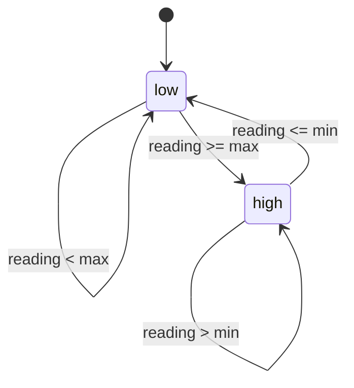
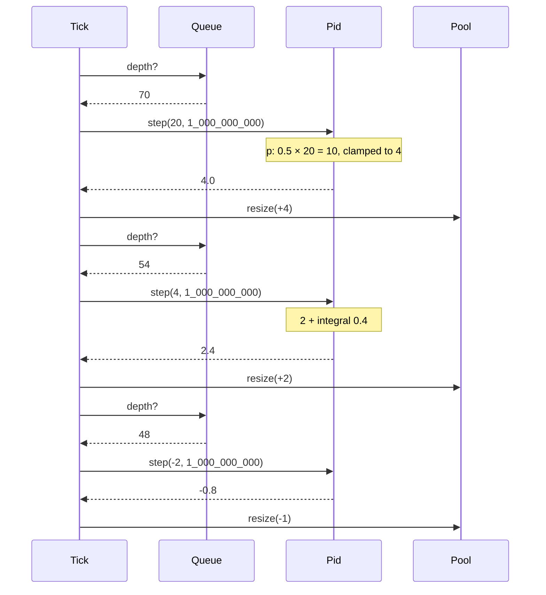

# FeedbackMachines

> Proportion, memory, and anticipation. The three things a threshold doesn't have. 🎛️

Two small control loops for Ruby. A `Pid` turns "how far off are we" into "how much to adjust", bounded so it can never ask for more than the actuator can give. A `Hysteresis` band turns a noisy reading into a clean on/off decision that doesn't flap. You supply the measurements and the clock. They supply the arithmetic.

## Quick Start

```bash
gem 'feedback_machines'
```

```ruby
# Keep the job queue near 50 pending by adding or removing workers.
Gains  = FeedbackMachines::Gains    # p, i, d
Limits = FeedbackMachines::Limits   # min, max

pid  = FeedbackMachines::Pid.new(Gains.new(0.5, 0.1, 0.0), Limits.new(-4.0, 4.0))
last = Process.clock_gettime(Process::CLOCK_MONOTONIC, :nanosecond)

loop do
  now   = Process.clock_gettime(Process::CLOCK_MONOTONIC, :nanosecond)
  delta = pid.step(queue.depth - 50, now - last)   # error, elapsed nanoseconds
  last  = now
  pool.resize(pool.size + delta.round) if delta.is_a?(Float)
  sleep 1
end
```

```ruby
# Flip into shed mode above 80% CPU, back out below 60%, nothing in between.
band = FeedbackMachines::Hysteresis.new(Limits.new(0.6, 0.8))

shed_mode = band.observe(cpu.utilization) == :high
```

## A Message to the Resistance

So the queue backed up and you wrote the autoscaler. If depth is over 100, add a worker. If it's under 10, remove one. Ship it.

Monday morning the depth hits 101. A worker spins up. It takes 20 seconds to boot, by which time depth is 140 and the rule has fired three more times. Four new workers drain the queue to zero in a minute. Now depth is under 10, so the rule removes them, one per tick, and the queue backs up again. Your dashboard looks like a seismograph and ops has named the pattern after you.

The problem isn't the rule. The problem is that a threshold has no memory and no sense of proportion. It can't tell "a little over" from "catastrophically over", and it can't tell "climbing" from "already falling". Control engineers solved this in the 1920s for steering ships. A proportional term scales the response to the size of the error. An integral term remembers how long you've been off. A derivative term notices which way you're heading. Clamp the output so you never ask for forty workers at once, and stop accumulating when you're already clamped so the controller doesn't owe the universe an impossible correction later.

That is what `Pid` does. `Hysteresis` is the same cure for on/off decisions: two thresholds instead of one, so a reading hovering at 79.9% doesn't toggle shed mode fifty times a minute.

## Chapter 1: Stardate 2025.186, the AMS Maxwell

> **AMS Maxwell**, NCC-4208, *Maxwell*-class guidance tender.
> Correct the heading without teaching the thrusters to oscillate forever.

The tender doesn't fly the ship. It takes a heading error and a sampling interval and returns a thruster command the engines can actually execute. The helm reads the compass and fires the thrusters. The tender just makes sure that when the ship is one degree off, the correction is one degree's worth, and when it has been two degrees off for ten minutes, somebody finally does something about it.

On the bridge, a cadet proposes:

```ruby
def correct_heading
  if compass.error > 0
    thrusters.fire(:port, 100)
  elsif compass.error < 0
    thrusters.fire(:starboard, 100)
  end
end
```

"That," says the navigator, "is how a ship ends up pointing everywhere except where it's going."

## The Flight Plan

The hysteresis band has two states and refuses to change its mind in the middle.



And one tick of the queue autoscaler:



## How the Pid Works

Every example below uses these:

```ruby
Gains  = FeedbackMachines::Gains
Limits = FeedbackMachines::Limits
SECOND = 1_000_000_000   # elapsed time is Integer nanoseconds
```

### Proportional

With only `p` set, the output is the error times the gain, clamped to the limits.

```ruby
pid = FeedbackMachines::Pid.new(Gains.new(1.0, 0.0, 0.0), Limits.new(-10.0, 10.0))

pid.step(3.0, SECOND)    # => 3.0
pid.step(-3.0, SECOND)   # => -3.0
pid.step(30.0, SECOND)   # => 10.0, clamped
```

### Integral, without windup

Add `i` and the controller starts remembering. Each step adds `error × elapsed` to a running total. But when the output is already pinned at a limit, the total stops growing. That's the part that keeps a saturated actuator from accumulating a debt it can never repay.

```ruby
pid = FeedbackMachines::Pid.new(Gains.new(1.0, 1.0, 0.0), Limits.new(-10.0, 10.0))

pid.step(100.0, SECOND)  # => 10.0, clamped, integral frozen
pid.step(1.0, SECOND)    # => 2.0, not 101.0
pid.step(1.0, SECOND)    # => 3.0, integral climbing normally now
```

Without that guard, the second step would try to pay back a hundred units of accumulated error and overshoot for the next minute.

### Derivative

Add `d` and the controller reacts to the *rate* of change. The first step has nothing to compare against, so the derivative term is zero.

```ruby
pid = FeedbackMachines::Pid.new(Gains.new(0.0, 0.0, 1.0), Limits.new(-100.0, 100.0))

pid.step(5.0, SECOND)       # => 0.0, no history yet
pid.step(6.0, SECOND / 2)   # => 2.0, rose by 1 over half a second
pid.step(6.0, SECOND / 2)   # => 0.0, holding steady
```

### Bad samples don't poison the history

A zero interval, a NaN reading, or an infinite one is refused: `step` answers a symbol saying why and leaves the controller exactly as it was. Skip that tick and carry on.

```ruby
pid = FeedbackMachines::Pid.new(Gains.new(1.0, 1.0, 0.0), Limits.new(-10.0, 10.0))

pid.step(2.0, SECOND)          # => 4.0
pid.step(2.0, 0)               # => :invalid_duration
pid.step(Float::NAN, SECOND)   # => :not_finite
pid.step(2.0, SECOND)          # => 6.0, as if the two bad ticks never happened
```

An output is always a `Float`, a refusal is always a `Symbol`, and there is never a `nil`.

## How the Band Works

Two thresholds. The band starts `:low` and only goes `:high` when a reading reaches `max`. It only comes back down when a reading falls to `min`. Everything in between keeps whatever it was.

```ruby
band = FeedbackMachines::Hysteresis.new(Limits.new(0.6, 0.8))

band.observe(0.7)    # => :low, started low, not at max yet
band.observe(0.85)   # => :high
band.observe(0.7)    # => :high, in the dead zone, holds
band.observe(0.79)   # => :high, still holds
band.observe(0.6)    # => :low, reached min
band.observe(0.7)    # => :low, dead zone again, holds
band.state           # => :low, without observing anything
```

A non-finite reading answers `:not_finite` and the band keeps its state.

## The Rules of the Tender

- **Configuration is two values, passed positionally.** `Gains.new(p, i, d)` and `Limits.new(min, max)` mirror the core's structs, field for field. `Pid.new(gains, limits)`, `Hysteresis.new(limits)`. There are no keyword shortcuts and no default gains: say all three.
- **Gains are finite and nonnegative.** Negative or infinite `p`, `i`, or `d` raises `RangeError` from `Gains.new`. Flip the sign of your error instead.
- **Limits need `min < max`.** Equal, reversed or non-finite raises `RangeError` from `Limits.new`. Same value type for the band.
- **`elapsed` is a span in Integer nanoseconds**, not a timestamp and not seconds: subtract two `Process.clock_gettime(Process::CLOCK_MONOTONIC, :nanosecond)` readings. A Float raises `TypeError`, a negative one raises `RangeError`. Zero is refused with `:invalid_duration`.
- **Errors, gains, limits and outputs are Floats.** They are control quantities, not time. Integers are accepted and treated as floats.
- **A refusal is a symbol, never an exception, and changes nothing.** Not the integral, not the derivative history, not the band's side.
- **Nothing to repeat.** Every honoured `step` is a new sample; the controller keeps no record of past calls, so feeding the same sample twice is two samples.
- **No ids, no clock.** Nothing is issued and nothing reads the time. A controller's state lives in memory; a restart starts from zero.
- **Frozen means frozen.** `freeze` a controller or a band and every `step` or `observe` raises `FrozenError`.
- **Each controller is its own loop.** Two `Pid` instances share nothing, and they can't be `dup`ed or `clone`d.

### Every answer

A call that is honoured answers with a value. A call that is not honoured answers with one of the refusal symbols below, the snake_case of a core `Refusal` variant, and changes nothing. There is no catch-all symbol.

| Call | Honoured | Refusals |
| --- | --- | --- |
| `Gains.new(p, i, d)` | `Gains` | none; an invalid gain raises `RangeError` |
| `Limits.new(min, max)` | `Limits` | none; an invalid range raises `RangeError` |
| `Pid.new(gains, limits)` | `Pid` | none |
| `Pid#step(error, elapsed)` | `Float` within the limits | `:not_finite` (error is NaN or infinite), `:invalid_duration` (elapsed is zero), `:overflow` (a term of the calculation is not finite) |
| `Pid#gains`, `Pid#limits` | `Gains`, `Limits` | none, a query |
| `Hysteresis.new(limits)` | `Hysteresis`, starting `:low` | none |
| `Hysteresis#observe(value)` | `:low`, `:high` | `:not_finite` |
| `Hysteresis#state` | `:low`, `:high` | none, a query |
| `Hysteresis#limits` | `Limits` | none, a query |

## What You Think You're Doing vs Reality

### You Think: "I'll just add a worker when the queue is over 100."
### Reality: You built an oscillator with a twenty-second period.

A threshold reacts to where you are. It has no idea how fast you got there or how long you've been stuck. By the time the action lands, the situation has moved, so the action is wrong, so the next action overcorrects. Proportion, memory, and anticipation are the three things a threshold lacks, and they're the three letters in PID.

## What's Yours

The controller doesn't read sensors, run timers, or touch actuators. You decide what "error" means, how often to sample, what to do with the number that comes back, and what gains make sense for your system. Start with `p` alone and zero for the other two, raise `i` when the system settles short of the target, raise `d` only if it overshoots.

## License

MIT License. See [LICENSE.txt](LICENSE.txt) for details.

**Remember: A threshold tells you that you're off course. A controller tells you by how much, for how long, and which way you're drifting.**
